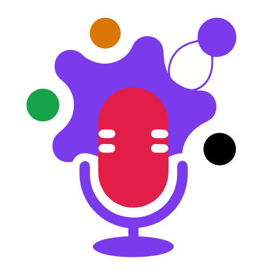
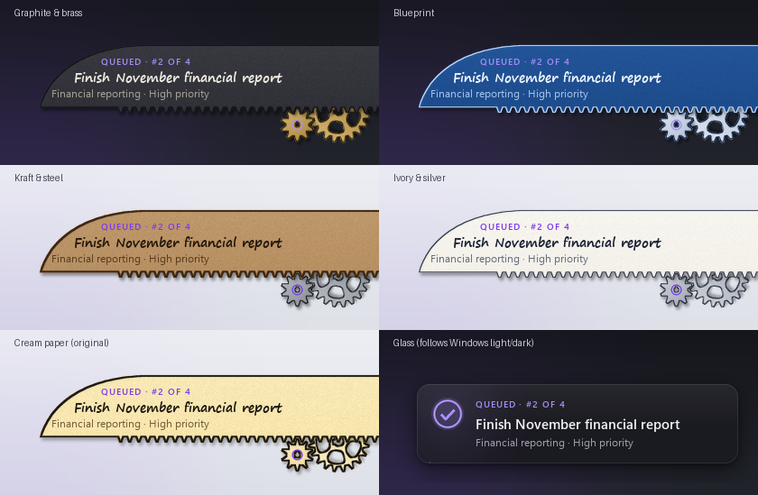

<p align="center">
  <picture>
    <source media="(prefers-color-scheme: dark)" srcset="assets/brand/logo-dark.svg">
    
  </picture>
</p>

<h1 align="center">DictateIt</h1>

<p align="center">
  <b>Talk to Windows. It types for you, keeps your tasks, and remembers where you left off.</b><br>
  Local Whisper dictation · voice task queue · context that follows your work · no window to manage
</p>

<p align="center">
  
  
  
  
</p>

<p align="center">
  
</p>

---

## What it does

| | |
| :--- | :--- |
| 🎙️ **Dictate anywhere** | `Ctrl+Alt+D`, speak, and the text lands where your cursor is: VS Code, Chrome, Slack, Word, terminals. Whisper runs on your GPU; ~150–250 ms on an RTX card. |
| ✅ **Tasks by voice** | `Ctrl+Alt+T`: *"add finish the November report, it's important"*, *"DP World is done"*, *"pause the report"*. No window, no typing; a card confirms and gets out of the way. |
| 🧭 **Keeps your place** | It notices which app, file, tab or site you're working in, links that to the task, and when you drift away asks once: *"Wrapped up?"*. Come back later and it tells you where you were. |
| 🧠 **Learns your words** | Pick the right task once and the phrase you used is remembered. Names from your tasks (GGEA, Jebel Ali, GDA6…) become spelling hints for speech recognition. |

It lives in the system tray. The only UI is the cards.

## The cards

Each card is a plate with a gear rack along its bottom edge, driven by a real gear train: a big drive gear centred
on the card's bottom line turns a small pinion, and the pinion feeds the plate out. The teeth share one module, so
they stay meshed the whole way out and back in. Done gets a green ink strike and a stamp before it's dispensed;
removed gets scribbled out and tears loose; the queue (`Ctrl+Alt+Q`) is a column of tickets.

Pick a look from the tray menu under **Look**:

<p align="center"></p>

Cards never take focus from the app you're typing in, follow Windows' *show animations* setting (fades only when
it's off), switch to system colours in high-contrast mode, and are read aloud when a screen reader is running.

## Quick start

```powershell
git clone https://github.com/abdullahbilal-y/dictate-it.git
cd dictate-it
pip install -r requirements.txt
python main.py --install     # DictateIt.exe + Start Menu entry + start at sign-in
```

`--install` builds `bin\DictateIt.exe` (shown as **DictateIt** with its logo in Task Manager), adds **DictateIt** to the
Start Menu so you can search for it, and starts it a few seconds after you sign in. Opening it again while it's
running just shows its *ready* card.

Prefer a console with live logs? `python main.py`. Plain dictation only? `python main.py --no-tasks`.

## Keys

| Keys | Tap | Hold |
| :--- | :--- | :--- |
| `Ctrl + Alt + D` | Start dictating; tap again to paste | Talk while holding, release to paste |
| `Ctrl + Alt + T` | Start a task command; tap again to finish | Talk while holding, release to finish |
| `Ctrl + Alt + Q` | Show / hide the queue | Peek while holding |
| `Esc` (while listening) | Cancel: nothing is pasted or saved | |

Holding a key fires once (key repeat is ignored), recordings you forget about stop on their own, and every hotkey
can be changed in `config.json`.

## Talking to your queue

| Say (after `Ctrl+Alt+T`) | What happens |
| :--- | :--- |
| "Add call Amer about the EIR OCR model" | **Queued · #3 of 5**, project and priority guessed |
| "This is urgent, send the invoice to Alpha" | Added as urgent |
| "DP World is done" / "account is fixed" / "done that" | Completed: the best match, or the task you just added |
| "All DP World tasks are done" | Completes every match |
| "Pause the report" · "waiting on finance" · "switch to the deck" | Paused / Waiting / Now working on |
| "What's next?" | The queue |
| "Undo" | Reverts the last change (Done and Removed cards also have an **Undo** button) |

When two tasks fit equally, you get **"Which one is done?"** with the candidates to click, never a guess and never a
stray new task. Your pick teaches it that phrase.

## Context, and what leaves your PC

Once a second the watcher reads the foreground **app name and window title**, and for browsers the **active tab's
title and address** (read from the address bar via Windows UI Automation, no extension). That's all it reads.

- If no task is active and you settle into a window, one card asks **"Working on this?"**. Your answer links that
  window to the task, so when you leave it for ~2 minutes you get **"Wrapped up? Done / Not yet / Waiting"**.
- It never completes anything by itself, and holds questions back during full-screen apps, presentations and Focus.

| | Stays on your PC | Sent, only if you add a key |
| :--- | :--- | :--- |
| Dictation audio and text | ✅ always | Only if you tick *Groq speech for dictation* |
| Task-command audio | without `GROQ_API_KEY` | Groq Whisper, speech-only, trimmed |
| Task titles, window titles, tab addresses | ✅ | To the AI for understanding/linking, with query strings and `#fragments` removed |
| Incognito / InPrivate windows, password managers | ✅ never read | never |
| Screenshots, page or file contents | never read | never |

Everything sent to an AI is built in one file, [`dit/ai/prompts.py`](dit/ai/prompts.py). Tasks live in SQLite at
`%LOCALAPPDATA%\DictateIt\dictateit.db`.

## Optional: free AI and better speech

Everything works offline with local rules and local Whisper. Add free keys to `.env` (see [`.env.example`](.env.example))
and it gets sharper:

| Key | What it adds | Free tier |
| :--- | :--- | :--- |
| `GROQ_API_KEY` | Whisper **large-v3** for task commands, plus fast command understanding | 2,000 speech + 1,000 chat requests/day |
| `OPENROUTER_API_KEY` | Backup command understanding and window linking | 50 requests/day |

Commands are applied instantly by local rules; the AI refines in the background or resolves what the rules
can't, so a slow or exhausted free tier never blocks you. Usage is synced with the providers' own counters.

## Under the hood

| | |
| :--- | :--- |
| Speech | `faster-whisper` (CUDA float16 / CPU int8), Silero VAD, vocabulary hints from your tasks (word errors 24% → 6% on synthesized real task phrases) |
| Cards | Win32 layered window (per-pixel alpha, never activates), Pillow renderer, spring-based stack, ~2 ms per card per frame |
| Context | foreground window + UI Automation for browser tabs, a sessionizer that ignores Alt-Tab blips |
| Tasks | SQLite: tasks, history, context links, learned phrases and vocabulary |
| Startup | Task Scheduler logon task, single-instance mutex, logs at `%LOCALAPPDATA%\DictateIt\dictateit.log` |

The project brain explains the design and every trap hit along the way:
[architecture](brain/architecture.md) · [landmines](brain/landmines.md) · [operations](brain/operations.md).

```powershell
python main.py --test        # self-test: Whisper, mic, task logic, context parsing, hotkeys, every card
python main.py --demo-ui     # play every card animation on screen
python tools/stt_bench.py    # speech accuracy bench on real task phrases
python tools/make_media.py   # regenerate the images in this README
```

<details>
<summary><b>Configuration</b> (<code>config.json</code>, created when you change a setting)</summary>

| Setting | Default | |
| :--- | :--- | :--- |
| `hotkey` / `task_hotkey` / `peek_hotkey` | `ctrl+alt+d` / `ctrl+alt+t` / `ctrl+alt+q` | Any `keyboard` combo, e.g. `f8` |
| `mode` | `toggle` | `toggle` (tap or hold) or `ptt` (hold only) |
| `model_name` | `small` | `tiny`, `small`, `medium`, `large-v3-turbo`… |
| `card_style` / `paper_theme` | `paper` / `graphite` | `glass`; `blueprint`, `kraft`, `ivory`, `paper` |
| `custom_vocabulary` | `[]` | Names speech recognition keeps getting wrong |
| `stt_cloud_routes` | `["task"]` | Add `"dictate"` to send dictation to Groq too |
| `nudge_after_s` / `checkin_after_s` | `120` / `90` | When to ask "Wrapped up?" / "Working on this?" |
| `read_browser_urls` | `true` | `false` keeps tab addresses out entirely |
| `private_apps` | password managers | Never read or sent |

</details>

<details>
<summary><b>Troubleshooting</b></summary>

- **Doesn't start at sign-in:** run `python main.py --install` again; it replaces the old Startup-folder shortcut with a logon task.
- **Stuck at "Loading Whisper":** a broken model download. Close DictateIt, delete `%USERPROFILE%\.cache\huggingface\hub\models--Systran--faster-whisper-small\blobs\*.incomplete`, start again.
- **A hotkey does nothing in an admin window:** Windows blocks hooks into elevated apps; run DictateIt as admin if you need that.
- **Anything else:** the log at `%LOCALAPPDATA%\DictateIt\dictateit.log` has a line for every command, context switch and AI call.

</details>

## License

MIT, see [LICENSE](LICENSE). Made by [Abdullah Bilal](https://github.com/abdullahbilal-y).
